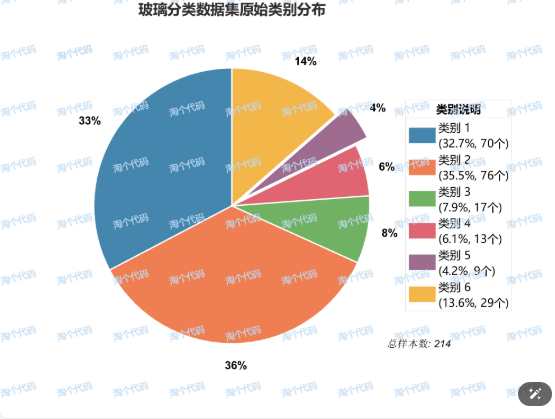
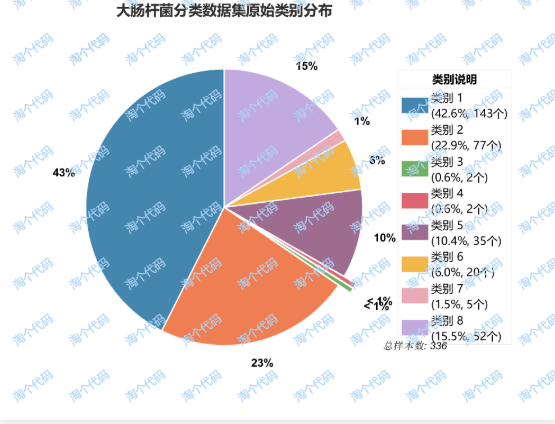
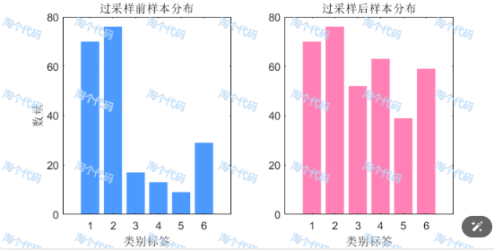
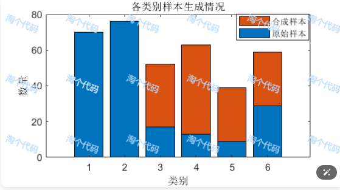
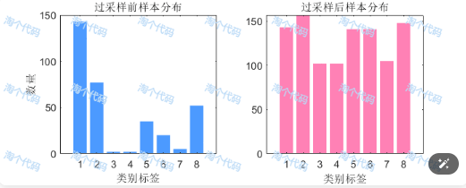
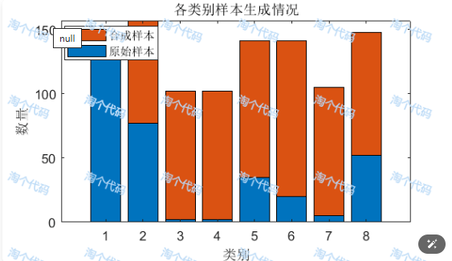
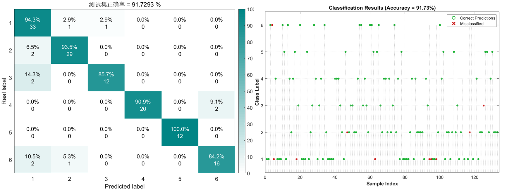
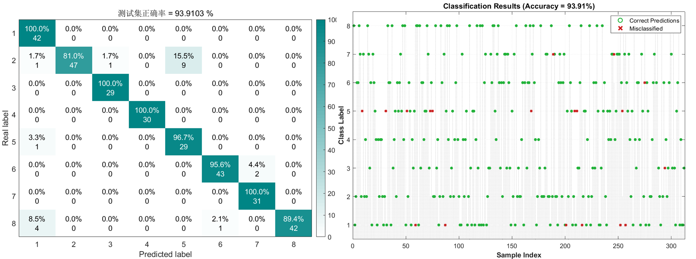
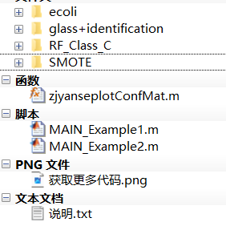

# SMOTE+ Variants in Real-World Implementation: Data Imbalance? Model Accuracy Soars by 25%!

No need to panic about sample imbalance! SMOTE helps you "create data" so that the model no longer "biased". In the world of data science, we always hope our dataset is "both large and comprehensive"—with balanced distributions of various samples, like a fair party where each category has enough "speaking power". However, reality is often cruel: whether it's rare disease samples in medical diagnosis, fraudulent transactions in financial risk control, or equipment failures in industrial testing, the minority class samples are always scarce. This issue of data imbalance is like giving models "colored glasses," making them frequently "blind" in key tasks.
Today, let's talk about the "deadly wound" of data imbalance and introduce classic methods such as SMOTE and ADASYN for data augmentation, as well as two variants of SMOTE: BorderlineSMOTE and SafeLevelSMOTE.
I. Data Imbalance: The Culprit of Model Bias
In classification tasks, data imbalance refers to the significant difference in the number of samples from different classes. At this point, traditional classification models face two deadly problems:
1. Majority class "captures" the model: The model tends to categorize all samples as the majority class (e.g., "ordinary glass"). This is because "mistakes cost the least." Just like students who encounter questions they don't understand on exams, they might choose "C" more likely to be correct, but critical questions (minority class) could be wrong.
2. Minority class features are overlooked: The minority class samples are too few to capture their unique feature patterns.
Take an extreme example:
If 99% of the samples are benign tumors, and only 1% are malignant, a "foolish model" could predict "all benign" with a high accuracy rate, but it would miss all malignant cases. Such a model is useless.
Data imbalance is essentially the model "seeing only the forest, not the trees." To solve this problem, the core idea is to give the minority class "enough voice"—over-sampling is the most commonly used method, and SMOTE is its top choice.
II. SMOTE: The "Intelligent Generator" for Minority Classes
Traditional oversampling is straightforward—copying minority samples (e.g., duplicating ten special glass samples to make a total of 100). However, this approach has a significant problem: overfitting. The model memorizes these repetitive samples and fails to recognize real new data.
The idea behind SMOTE is more intelligent: it generates "virtual but reasonable" new samples instead of simply copying. Its core steps can be summarized in three words: find neighbors, interpolate, and generate.
Detailed Explanation: 1. Find neighbors: For each minority class sample (represented as A), calculate its distance from other minority class samples (commonly Euclidean distance) and identify the k nearest neighbors (e.g., k=8).
2. Interpolate generation: Between sample A and its neighbor (represented as B), randomly select a point (e.g., between A and B on a line, choose a random factor λ between 0 and 1 to generate a new sample: A + λ*(B - A)). This new sample retains the characteristics of A while incorporating those of B, like an "interbreeding" between A and B.
3. Mass production: Repeat this process for each minority class sample until the desired synthesis count is reached.
For example, if a special glass sample has a refractive index of 1.516 and iron content of 0.05%, its neighbors might include samples with refractive indices of 1.518 and iron contents of 0.06%. SMOTE will generate new samples similar to (1.516 + λ*(1.518 - 1.516), 0.05% + λ*(0.06%-0.05%)), ensuring that these new data points follow the true distribution patterns.
Advantages: • Reject "mechanical replication": The generated new samples are "reasonable extensions" of the original samples, avoiding models memorizing repetitive data and enhancing generalization capabilities.
• Maintain data distribution: Through neighbor interpolation, new samples do not deviate from the minority class feature space (e.g., they do not generate glass with a refractive index of 1.6, which would not be possible in the original data).
• Flexible and Extensible: SMOTE comes in many variants (such as ADASYN, BorderlineSMOTE, etc., as used in the code). For example:
• ADASYN automatically generates more new data for minority classes that are "harder to classify".
• BorderlineSMOTE only generates samples in the "boundary area" between majority and minority classes, avoiding confusion of categories.
• SafeLevelSMOTE: A dynamic sampling algorithm that adjusts the generation position of synthetic samples based on the safety level of the minority class samples around them (the proportion of the same type among neighboring samples), avoiding noise in overlapping category regions.

III. Practical Verification To verify the effectiveness of SMOTE, we validate it with the UCI classic "Glass Classification Dataset" and "Escherichia coli Dataset". The data sources are as follows:
- Glass Classification Data: https://archive.ics.uci.edu/dataset/42/glass+identification[1]
- Escherichia coli Classification Data: https://archive.ics.uci.edu/dataset/39/ecoli[2]

In the original glass dataset, there are six types of data, and the distribution is as follows:
\n        \n
In the original glass data, the sample counts of the six categories vary greatly (as shown in the above figure): the minimum category has only 9 samples, while the maximum has 76, making the model easily "biased" towards the majority class.
The same applies to the Escherichia coli data, which also contains eight types of data, with the distribution as follows:
\n        \n
In the original Escherichia coli data, the sample counts of the eight categories vary greatly (as shown in the above figure): the minimum category has only 2 samples, while the maximum has 143.
Practical steps: 1. Data import and statistics: Read the datasets, count the sample counts of each category.
2. Set up data augmentation methods: For example, use ADASYN, SMOTE, BorderlineSMOTE, or SafeLevelSMOTE; code can be easily replaced with one-click.
3. Set up distance functions: For instance, ["cityblock", "chebychev", "correlation", "cosine", "euclidean", "hamming", "jaccard", "mahalanobis", "minkowski", "seuclidean", "spearman"] etc., code can be easily changed with one-click.
4. Set the number of samples to generate: For categories with less sample volume, set the number of generated data (such as setting it to 60, 20, etc.), and the code can be simply modified.
5. Model training and evaluation: Train a random forest classifier using the balanced data after data augmentation, predict the original data and calculate accuracy, recall, F1 score, etc.
After oversampling, the sample volume of each category is significantly balanced (as shown in the right image below).
• Glass dataset data augmentation sample volume after oversampling
\n        \n      Stacked graph as follows:
\n        \n  
• Escherichia coli dataset data augmentation sample volume after oversampling
\n        \n  
Stacked graph as follows: classification results
\n        \n  
Classification results: Firstly, merge the generated new data with the original data, then divide into training set and test set, and use the classic random forest algorithm to train and test the synthetic data, the results are as follows:
• Glass dataset data augmentation classification results after oversampling
\n        \n  
• Escherichia coli dataset data augmentation classification results after oversampling
\n        \n  
After data augmentation, the model's ability to recognize minority classes has been greatly improved!
IV. Summary: Why SMOTE is Worth Using? Data imbalance is a common phenomenon in the real world, but models cannot "settle for less." SMOTE, through "intelligent data generation," gives minority classes sufficient "voice," preventing model bias. Whether it's in healthcare, finance, or industrial scenarios, it's an essential tool for addressing data imbalance.
Of course, SMOTE has its limitations (such as sensitivity to high-dimensional data or noise), and in practical applications, variants need to be chosen based on specific problems (e.g., BorderlineSMOTE is suitable for scenarios with blurred boundaries). However, understanding the principles and advantages of SMOTE is a crucial skill for data scientists.
Code screenshot:
\n        \n

## Images

<!-- PAYMENT_BLOCK -->

## Get this dataset

- Payment link (Stripe): [Buy now](https://buy.stripe.com/3cs8yP7sY87d0vu9AB)
- Payment QR code: 

<!-- /PAYMENT_BLOCK -->
